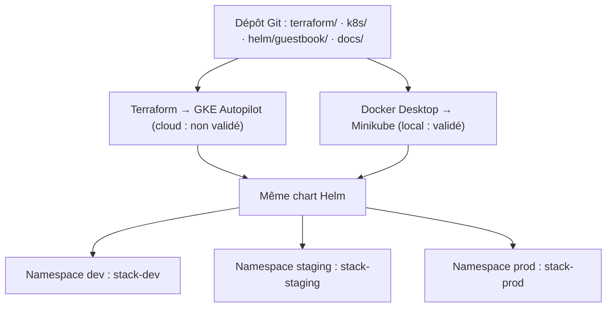
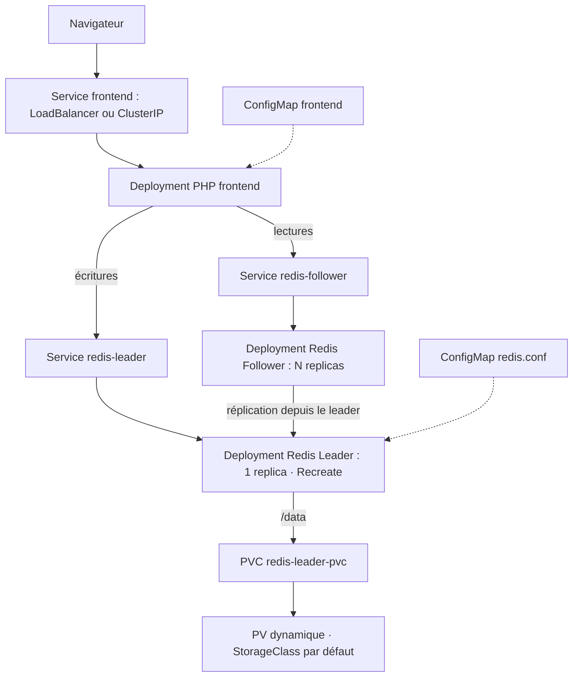

# Livre d’or Cloud — Kubernetes, Helm, Terraform & GKE Autopilot

> **Projet pédagogique Cloud Hôtels — transfert en exploitation.** Une application Guestbook PHP + Redis, persistante et déployable dans trois environnements isolés, en local sur Minikube et, lorsque l'accès au laboratoire le permet, sur Google Kubernetes Engine (GKE) Autopilot.

**Dépôt :** [github.com/ahmedjer/livre-or-cloud](https://github.com/ahmedjer/livre-or-cloud)  
**Documentation :** [Architecture](docs/architecture.md) · [Runbooks d’exploitation](docs/runbooks.md) · [Preuves locales](docs/evidence/)

## 1. État d’avancement et périmètre

| Domaine | État au 1er novembre 2026 | Preuve / commentaire |
|---|---|---|
| Manifestes Kubernetes sur Minikube | **Validé** | Pods, Services, ConfigMaps, PVC et probes |
| Redis persistant et réplication leader/followers | **Validé** | Données préservées lors de redémarrages ; réplication active |
| Helm : `dev`, `staging`, `prod` | **Validé** | Trois releases `deployed` avec le même chart |
| Helm upgrade / rollback | **Validé** | Staging : révisions 1 → 2 → 3 (rollback vers 1) |
| Migration de `dev` de `kubectl` vers Helm | **Validé** | PVC et PV d’origine conservés |
| Terraform : init, fmt, validate | **Validé** | Module GKE v46.0.0 initialisé, configuration valide |
| GKE Autopilot : apply et tests cloud | **Non réalisé** | Accès Google Skills suspendu ; aucune ressource cloud n’a été créée |
| Idempotence `terraform plan` après `apply` | **À valider sur GKE** | Nécessite un projet de laboratoire actif |

**Important :** les commandes GKE de ce document constituent un **runbook préparé**, et non une preuve de déploiement effectif. Ne pas présenter le cloud comme déjà testé.

### Objectif métier

Cloud Hôtels souhaite afficher et conserver les messages laissés par ses clients. Le prototype initial perdait ses données au redémarrage : la solution ajoute un stockage persistant à Redis, externalise la configuration et automatise le déploiement.

### Frontière des responsabilités

- **Terraform** crée le cluster managé **GKE Autopilot**, à l’aide du module imposé ; il ne déploie pas Guestbook.
- **Kubernetes** exécute et isole les composants applicatifs, Services, ConfigMaps et PVC.
- **Helm** déploie, met à jour et restaure Guestbook dans les trois namespaces. Aucun objet applicatif GKE n’est déployé par Terraform.
- **Git** versionne la configuration, la documentation et le fichier `.terraform.lock.hcl`, jamais les états Terraform ni les identifiants du laboratoire.

## 2. Architecture



Dans **chaque** namespace :



Les noms de Services **`redis-leader`** et **`redis-follower`** sont indispensables à la résolution DNS utilisée par les images officielles Guestbook. Redis n’est pas exposé publiquement ; seuls les frontends peuvent être publiés.

### Environnements et capacités

| Ressource | `dev` | `staging` | `prod` |
|---|---:|---:|---:|
| Release Helm | `stack-dev` | `stack-staging` | `stack-prod` |
| Réplicas frontend | 1 | 2 | 3 |
| Redis Leader | 1 | 1 | 1 |
| Réplicas Redis Follower | 1 | 2 | 2 |
| PVC Redis Leader | 1 GiB | 1 GiB | 2 GiB |
| Port Service frontend local | 8080 | 8081 | 8082 |

Chaque namespace dispose de **3 Deployments, 3 Services, 2 ConfigMaps et 1 PVC**. Les messages ne sont pas partagés entre les environnements.

### Images et stratégies

| Composant | Image versionnée | Stratégie |
|---|---|---|
| Redis Leader | `docker.io/redis:6.0.5` | `Recreate` |
| Redis Follower | `us-docker.pkg.dev/google-samples/containers/gke/gb-redis-follower:v2` | `RollingUpdate` |
| Frontend PHP | `us-docker.pkg.dev/google-samples/containers/gke/gb-frontend:v5` | `RollingUpdate` |

Les Deployments définissent les ressources CPU/mémoire ainsi que les **readiness** et **liveness probes**. Le leader utilise le PVC monté sur `/data`, avec `appendonly yes` et `appendfsync always` dans `redis.conf`.

**Pourquoi `Recreate` ?** Le Redis Leader est l’unique écrivain sur le volume `ReadWriteOnce`. Éviter le chevauchement d’anciens et nouveaux Pods réduit les conflits d’accès au volume, au prix d’une brève indisponibilité pendant son redémarrage.

Détails : [docs/architecture.md](docs/architecture.md).

## 3. Structure du dépôt

```text
livre-or-cloud/
├── README.md                       # Point d'entrée / passation
├── .gitignore                      # Exclut secrets, state, caches et packages
├── k8s/                            # Manifestes Kubernetes de référence
│   ├── namespaces.yaml
│   └── *.yaml                       # Deployments, Services, ConfigMaps, PVC
├── helm/
│   └── guestbook/
│       ├── Chart.yaml              # Chart 0.1.1, appVersion 1.0.0
│       ├── values.yaml             # Valeurs par défaut documentées
│       ├── values-dev.yaml
│       ├── values-staging.yaml
│       ├── values-prod.yaml
│       ├── .helmignore
│       └── templates/              # 9 ressources, helpers, NOTES
├── terraform/
│   ├── versions.tf
│   ├── variables.tf
│   ├── main.tf
│   ├── outputs.tf
│   ├── terraform.tfvars.example
│   └── .terraform.lock.hcl
└── docs/
    ├── architecture.md
    ├── runbooks.md
    └── evidence/                   # Sorties de contrôles Minikube
```

Les répertoires générés `.terraform/` et `helm/packages/`, le vrai `terraform.tfvars`, les fichiers `*.tfstate` et les identifiants sont exclus du dépôt.

## 4. Prérequis et accès

**Poste de référence :** Windows 11, PowerShell, VS Code, Git, Docker Desktop, Minikube, `kubectl`, Helm, Terraform, Google Cloud CLI et `gke-gcloud-auth-plugin`.

Versions observées pendant la réalisation : Terraform **1.16.6**, Docker **29.9.2**, Kubernetes Minikube **v1.37.0**, Helm **4.3.1**. Les versions de providers sont fixées dans `terraform/.terraform.lock.hcl` ; vérifier ce fichier lors de la reprise.

```powershell
# Depuis un nouveau poste : cloner un dépôt privé avec son compte GitHub autorisé.
git clone https://github.com/ahmedjer/livre-or-cloud.git
cd .\livre-or-cloud

# Vérifier les outils.
docker version
minikube version
kubectl version --client
helm version
terraform version
gcloud.cmd version
gke-gcloud-auth-plugin --version
```

**Sous PowerShell**, préférer `gcloud.cmd` si l’exécution de `gcloud.ps1` est bloquée par l’Execution Policy. Pour le cloud, n’utiliser **que le projet et l’identité temporaires autorisés du laboratoire**, jamais un compte personnel facturé sans accord.

## 5. Recréer l’environnement local Minikube (PowerShell)

> Les commandes suivantes s’appliquent à un **nouveau cluster**. Si les releases existent déjà, ne pas relancer `helm install` : consulter les commandes d’exploitation § 7.

### 5.1 Démarrer et vérifier Minikube

Démarrer **Docker Desktop**, puis :

```powershell
minikube start --driver=docker
kubectl config use-context minikube
kubectl config current-context
kubectl get nodes
kubectl get storageclass
```

Résultat attendu : nœud `minikube` **Ready** et une StorageClass par défaut (`standard` sur l’environnement de référence).

### 5.2 Vérifier et déployer le chart

```powershell
helm lint .\helm\guestbook -f .\helm\guestbook\values-dev.yaml
helm lint .\helm\guestbook -f .\helm\guestbook\values-staging.yaml
helm lint .\helm\guestbook -f .\helm\guestbook\values-prod.yaml

# Sur un cluster neuf, utiliser le nom de release comme sélecteur dev.
# L'override guestbook du fichier values-dev.yaml sert UNIQUEMENT
# à la migration historique des Deployments dev existants.
helm install stack-dev .\helm\guestbook `
  -n dev --create-namespace `
  -f .\helm\guestbook\values-dev.yaml `
  --set-string selectorInstanceOverride= `
  --wait --timeout 10m

helm install stack-staging .\helm\guestbook `
  -n staging --create-namespace `
  -f .\helm\guestbook\values-staging.yaml `
  --wait --timeout 10m

helm install stack-prod .\helm\guestbook `
  -n prod --create-namespace `
  -f .\helm\guestbook\values-prod.yaml `
  --wait --timeout 10m
```

Attendu : 3 releases `deployed`, Deployments prêts et PVC `Bound`.

```powershell
helm list -A
kubectl get deployments -n dev
kubectl get deployments -n staging
kubectl get deployments -n prod
kubectl get pvc -A
kubectl get svc,endpoints -n dev
```

### 5.3 Accéder à l’interface Web

Dans **un autre terminal PowerShell**, laisser tourner :

```powershell
minikube tunnel
```

Puis consulter les Services et les URL locales constatées sur le poste de référence :

```powershell
kubectl get svc frontend -n dev
kubectl get svc frontend -n staging
kubectl get svc frontend -n prod
```

- Dev : **http://127.0.0.1:8080**
- Staging : **http://127.0.0.1:8081**
- Prod : **http://127.0.0.1:8082**

Ces adresses nécessitent `minikube tunnel` et dépendent du réseau local. Alternative sans tunnel :

```powershell
kubectl port-forward -n dev svc/frontend 18080:8080
# Ouvrir http://127.0.0.1:18080 dans le navigateur.
```

### 5.4 Pourquoi `values-dev.yaml` a une surcharge spéciale

Le `dev` historique était initialement géré par `kubectl apply` avec des sélecteurs immuables `app.kubernetes.io/instance=guestbook`. Lors de son adoption par `stack-dev`, le chart a reçu `selectorInstanceOverride: guestbook` pour **préserver les Deployments et le PVC existants**. Sur **un cluster neuf**, passer `--set-string selectorInstanceOverride=` pour obtenir `stack-dev` comme valeur du sélecteur. Conserver cet override sur les futurs `helm upgrade` du `dev` créé ainsi, afin d’éviter de modifier un selector immuable.

**Ne jamais exécuter `kubectl delete -f k8s/` sur l’environnement historique :** le dossier contient un PVC et cela pourrait supprimer les données.

## 6. Infrastructure cloud GKE — procédure préparée, non validée

**Statut : non exécuté** (compte Google Skills suspendu le 1er novembre 2026). Le laboratoire prévu est [Google Skills](https://www.skills.google/paths/11/course_templates/2/labs/619578). Il faut un accès valide, une durée de session adaptée, un projet autorisant GKE Autopilot et les APIs nécessaires. La région et le Project ID ne doivent jamais être inventés : ils sont fournis par le laboratoire à chaque session.

### 6.1 Terraform : module, providers et variables

Module **imposé** : `terraform-google-modules/kubernetes-engine/google//modules/beta-autopilot-public-cluster` version `~> 46.0` (version `46.0.0` récupérée lors de l’initialisation). `main.tf` ne définit pas directement de ressource `google_container_cluster`.

| Variable | Type | Obligatoire | Par défaut / règle |
|---|---|---|---|
| `project_id` | string | Oui | ID temporaire du laboratoire |
| `cluster_name` | string | Non | `autopilot-cluster-1` |
| `region` | string | Oui | Région fournie / autorisée par le laboratoire |
| `network` | string | Non | `default` |
| `subnetwork` | string | Non | `default` |
| `ip_range_pods` | string ou null | Non | `null` |
| `ip_range_services` | string ou null | Non | `null` |
| `release_channel` | string | Non | `REGULAR` |
| `deletion_protection` | bool | Non | `false` (pour la destruction du lab) |

**Providers déclarés** dans `versions.tf` : `hashicorp/google` (`~> 8.0`), `hashicorp/google-beta` (`~> 8.0`), `hashicorp/kubernetes` (`~> 2.0`), `hashicorp/random` (`~> 3.0`). Les versions exactes de la machine sont verrouillées dans `.terraform.lock.hcl` (reproductibilité), et peuvent différer d’une nouvelle installation après mise à jour explicite du lock.

**Outputs** dans `outputs.tf` : `cluster_name`, `cluster_id`, `cluster_location`, `project_id`, `cluster_endpoint` (**sensitive**), `kubernetes_version`, `release_channel` et `gke_connection_command`. Le résultat `terraform output -raw gke_connection_command` est une commande de connexion prévue pour l’exploitation.

**State :** état Terraform **local** dans cet exercice éphémère, ignoré par Git, non partagé. Limites : sauvegarde et collaboration difficiles, risque de divergence/perte du state. Pour une exploitation réelle : backend distant sécurisé (par exemple GCS), contrôle d’accès et verrouillage.

### 6.2 Authentification au laboratoire et création du cluster

> Exécuter **uniquement après rétablissement de l’accès Google Skills**. L’authentification GCP locale et l’ADC doivent utiliser **l’identité temporaire autorisée**. Ne jamais transmettre des jetons, mots de passe ou fichiers JSON dans Git ou les preuves.

```powershell
# S'assurer de travailler avec le projet GCP temporaire autorisé.
gcloud.cmd auth login
gcloud.cmd auth application-default login
gcloud.cmd auth list

# Créer la configuration locale NON versionnée, après avoir relevé
# project_id et region dans le panneau du laboratoire.
Copy-Item .\terraform\terraform.tfvars.example .\terraform\terraform.tfvars
code .\terraform\terraform.tfvars

# Renseigner les valeurs REPLACE_WITH_LAB_PROJECT_ID et
# REPLACE_WITH_LAB_REGION, puis vérifier le projet actif.
# Utiliser ici les valeurs relevées dans le laboratoire.
$ProjectId = Read-Host 'Project ID du lab'
gcloud.cmd config set project $ProjectId

terraform -chdir=terraform init
terraform -chdir=terraform fmt -check
terraform -chdir=terraform validate
terraform -chdir=terraform plan
terraform -chdir=terraform apply

# Vérifier les outputs et l'idempotence (attendu : No changes).
terraform -chdir=terraform output
terraform -chdir=terraform plan
```

`terraform apply` nécessite confirmation de l’opérateur. Si GKE ne peut pas être créé (APIs, quotas, permissions ou réseau `default` indisponible), **ne pas changer silencieusement le module imposé** : documenter le blocage et contacter l’administrateur du laboratoire.

Les ressources effectivement créées (cluster et ressources associées au module) doivent être relevées par `terraform state list` **après** un `apply` réussi ; elles ne sont pas inventoriées tant que le cloud n’a pas été testé.

### 6.3 Connexion et déploiement Helm sur GKE

```powershell
$ProjectId   = terraform -chdir=terraform output -raw project_id
$Region      = terraform -chdir=terraform output -raw cluster_location
$ClusterName = terraform -chdir=terraform output -raw cluster_name

gke-gcloud-auth-plugin --version
gcloud.cmd container clusters get-credentials $ClusterName `
  --location $Region --project $ProjectId
kubectl config current-context
kubectl cluster-info
kubectl get nodes
```

**Contrôle obligatoire :** le contexte doit être celui du GKE autorisé et **pas** `minikube` avant chaque commande Helm. Sur un cluster **neuf** :

```powershell
# Phase 1 : accès privé ClusterIP, test par port-forward.
helm install stack-dev .\helm\guestbook `
  -n dev --create-namespace `
  -f .\helm\guestbook\values-dev.yaml `
  --set-string selectorInstanceOverride= `
  --set frontend.service.type=ClusterIP `
  --wait --timeout 15m

kubectl get pods,svc,pvc -n dev
kubectl port-forward -n dev svc/frontend 18080:8080
# Dans le navigateur : http://127.0.0.1:18080
```

Arrêter le port-forward avec `Ctrl+C` après validation, puis :

```powershell
# Phase 2 : ouverture publique par Helm (peut provisionner une IP externe).
helm upgrade stack-dev .\helm\guestbook `
  -n dev -f .\helm\guestbook\values-dev.yaml `
  --set-string selectorInstanceOverride= `
  --set frontend.service.type=LoadBalancer `
  --wait --timeout 15m

kubectl get svc frontend -n dev

# Les 2 autres environnements (chart et valeurs identiques au local).
helm install stack-staging .\helm\guestbook `
  -n staging --create-namespace `
  -f .\helm\guestbook\values-staging.yaml `
  --wait --timeout 15m

helm install stack-prod .\helm\guestbook `
  -n prod --create-namespace `
  -f .\helm\guestbook\values-prod.yaml `
  --wait --timeout 15m

helm list -A
kubectl get pvc -A
```

Les Services `LoadBalancer` GKE peuvent engendrer des coûts et des délais de création. Surveiller les quotas et respecter les instructions du laboratoire.

### 6.4 Tester persistance et idempotence sur GKE

Sur le cluster GKE **uniquement**, avec un environnement de test autorisé :

```powershell
# Enregistrer un marqueur, vérifier la lecture via le follower.
kubectl exec -n prod deployment/redis-leader -- redis-cli SET persistence_test hello
kubectl exec -n prod deployment/redis-follower -- redis-cli GET persistence_test

# Vérifier le PVC et la configuration Redis.
kubectl get pvc -n prod
kubectl exec -n prod deployment/redis-leader -- redis-cli CONFIG GET appendonly

# Après sauvegarde/accord d'opération : identifier le Pod à redémarrer.
$LeaderPod = kubectl get pods -n prod `
  -l app.kubernetes.io/component=redis-leader `
  -o jsonpath='{.items[0].metadata.name}'
# Test contrôlé : interrompt temporairement les écritures.
kubectl delete pod $LeaderPod -n prod
kubectl rollout status deployment/redis-leader -n prod --timeout=300s
kubectl exec -n prod deployment/redis-leader -- redis-cli GET persistence_test

# Idempotence Terraform après un apply.
terraform -chdir=terraform plan
# Attendu : No changes.
```

Pour l’idempotence Helm, comparer les Pods et leurs UID avant/après un `helm upgrade` sans changement de valeurs ni de version de chart. Une nouvelle **révision Helm** peut apparaître sans recréation des Pods : ne pas confondre historique Helm et changement de workload.

### 6.5 Nettoyage cloud (risque de destruction)

**Uniquement sur le cluster GKE de laboratoire**, après validation du contexte, accord de destruction et **sauvegarde externe** des données :

```powershell
kubectl config current-context
helm uninstall stack-dev -n dev
helm uninstall stack-staging -n staging
helm uninstall stack-prod -n prod
kubectl get pvc -A
```

Le chart **0.1.1** prévoit `helm.sh/resource-policy: keep` sur le PVC. Les PVC conservés peuvent persister après désinstallation ; leur suppression détruit potentiellement les données et doit faire l’objet d’une décision explicite et d’un contrôle des ressources cloud restantes. **Les releases historiques Minikube installées en chart 0.1.0 ne doivent pas être désinstallées sans vérification préalable de leur politique de rétention PVC.**

Après traitement des ressources conservées et vérification du projet/cluster visé :

```powershell
terraform -chdir=terraform destroy
```

Ce scénario de destruction GKE n’a pas encore été exécuté.

## 7. Exploitation courante (résumé)

**La documentation opératoire détaillée est dans [docs/runbooks.md](docs/runbooks.md).** Vérifier systématiquement `kubectl config current-context` avant les commandes suivantes.

| Opération | Commandes de référence | Vérification |
|---|---|---|
| État global | `helm list -A`, `kubectl get pods -A`, `kubectl get pvc -A` | Releases `deployed`, Pods Ready, PVC Bound |
| Diagnostiquer | `kubectl describe deployment redis-leader -n dev`, `kubectl get events -n dev`, `kubectl logs -n dev deployment/redis-leader` | Identifier événements et erreurs |
| Config Helm | `helm get values stack-staging -n staging`, consulter `values-staging.yaml` | Valeurs cohérentes |
| Scale frontend | `helm upgrade ... --set frontend.replicaCount=3` | `kubectl get deployment frontend -n staging` |
| Rollback | `helm history stack-staging -n staging`, `helm rollback stack-staging <REV> -n staging` | Ancienne configuration restaurée |
| Redis | `kubectl exec -n dev deployment/redis-leader -- redis-cli PING` | `PONG` |
| Réplication | `kubectl exec -n dev deployment/redis-follower -- redis-cli INFO replication` | `master_link_status:up` |
| Persistance | `kubectl get pvc -n dev`, Redis `CONFIG GET appendonly` | PVC `Bound`, AOF `yes` |
| Agrandir PVC | Vérifier `allowVolumeExpansion` de la StorageClass ; modifier valeurs/chart via Helm | PVC `Bound` avec nouvelle capacité ; ne jamais réduire |
| Switch cluster | `kubectl config get-contexts` puis `kubectl config use-context <CONTEXT>` | `kubectl config current-context` exact |

**Exemple upgrade sur staging**, depuis la racine (sur le cluster voulu) :

```powershell
helm upgrade stack-staging .\helm\guestbook `
  -n staging -f .\helm\guestbook\values-staging.yaml `
  --set frontend.replicaCount=3 --wait --timeout 10m
helm history stack-staging -n staging
kubectl get deployment frontend -n staging
```

**Retour arrière** : consulter `helm history` et sélectionner la révision stable :

```powershell
helm rollback stack-staging 1 -n staging --wait --timeout 10m
```

**Attention :** `1` est la révision testée lors du projet local ; sur une installation différente, sélectionner la révision correspondante dans l’historique. Sur Minikube, les données Redis ont été préservées pendant l’upgrade et le rollback.

### Sauvegarde, restauration et conservation

Le PVC protège contre certains redémarrages de Pod mais **n’est pas une sauvegarde indépendante**. Une copie de `dump.rdb` et de `appendonly.aof` a été effectuée hors du dépôt lors du test local. La **restauration complète n’est pas encore testée** et ne doit pas être présentée comme validée. Ne jamais utiliser `kubectl delete pvc` pour résoudre un échec de montage sans décision explicite.

## 8. Référence de configuration Helm

Le chart a une version source **0.1.1**, tandis que les trois releases locales installées affichent encore **0.1.0** : la modification de `Chart.yaml` ne met pas à jour les releases automatiquement.

| Paramètre / composant | Valeur / comportement | Portée |
|---|---|---|
| `frontend.replicaCount` | 1 / 2 / 3 | Dev / staging / prod |
| `frontend.service.type` | `LoadBalancer` en local, surcharge `ClusterIP` puis `LoadBalancer` dans GKE | Type d’exposition |
| Port frontend | 8080 / 8081 / 8082 | Services locaux distincts |
| Redis Follower | 1 / 2 / 2 réplicas | Dev / staging / prod |
| Redis Leader | 1 réplique `Recreate`, AOF | Dans chaque namespace |
| PVC Redis Leader | 1 GiB / 1 GiB / 2 GiB | Dev / staging / prod |
| `selectorInstanceOverride` | `guestbook` dans les valeurs dev historiques ; vide pour toute installation neuve | Compatibilité avec sélecteur immutable |

L’inventaire **exhaustif des clés Helm**, leurs valeurs par défaut et leurs commentaires se trouve dans [`helm/guestbook/values.yaml`](helm/guestbook/values.yaml) et les fichiers `values-<ENV>.yaml`. Vérification :

```powershell
helm show values .\helm\guestbook
helm template stack-dev .\helm\guestbook -n dev `
  -f .\helm\guestbook\values-dev.yaml `
  --set-string selectorInstanceOverride= `
  --set frontend.service.type=ClusterIP
```

Les images ont des versions explicites ; aucun tag `latest` n’est utilisé.

## 9. Preuves et contrôles effectués en local

Les sorties texte sont stockées dans [`docs/evidence/`](docs/evidence/) : Helm releases, Deployments, Services, PVC pour les trois environnements, historique du rollback et état Redis.

Résultats relevés sur Minikube :

- `stack-dev`, `stack-staging`, `stack-prod` au statut **deployed**.
- Réplicas frontend **1/2/3**, followers **1/2/2**, leader **1** dans chaque namespace.
- Trois PVC **Bound** (1 GiB, 1 GiB et 2 GiB).
- Historique staging **revision 1 install → 2 upgrade → 3 rollback vers 1**.
- La clé `persistence_test` conserve la valeur **`hello`** après redémarrage de Minikube.
- `redis-cli INFO replication` indique **`master_link_status:up`**.
- `redis-cli CONFIG GET appendonly` renvoie **`yes`**.

Les captures et résultats sont **datés** ; il est normal que les identifiants et l’âge des Pods changent lors d’une nouvelle session.

## 10. Dépannage déjà rencontré

| Symptôme | Cause observée / probable | Résolution non destructive |
|---|---|---|
| `terraform init`: « There is not enough space on the disk » | C: presque plein lors du téléchargement des providers | Libérer de l’espace, nettoyer uniquement les temporaires incomplets, puis relancer `terraform init` |
| `gcloud.ps1 cannot be loaded ... scripts is disabled` | Politique PowerShell | Utiliser **`gcloud.cmd`** plutôt que changer globalement la sécurité Windows |
| `kubectl` : `127.0.0.1:<PORT> connection refused` | Docker Desktop / Minikube arrêtés | Vérifier Docker, `minikube status`, redémarrer le profil existant puis `minikube update-context` |
| `Docker Desktop is unable to start` | Docker Engine indisponible | Démarrer Docker Desktop et diagnostiquer WSL/espace disque ; ne pas réinitialiser les volumes |
| `helm install`: resource already exists / immutable Deployment selector | Anciennes ressources `kubectl apply` sur `dev` | Migration documentée via `--take-ownership` et sélecteur compatible ; ne pas supprimer le PVC |
| `Pending PVC` | Provisioner / StorageClass non disponibles ou quotas | `kubectl get storageclass`, `kubectl describe pvc`, `kubectl get events` |
| Redis follower déconnecté | Réseau ou Service `redis-leader` indisponible | `kubectl get endpoints`, logs Redis, `INFO replication` |
| Google Skills : « compte suspendu » | Accès labo suspendu, cause non établie | Contacter le support ou l’administrateur ; **ne pas déclarer le déploiement GKE réussi** |

Le répertoire `docs/evidence/` ne doit contenir **ni sauvegardes de bases Redis ni secrets**.

## 11. Sécurité, risques et dette technique

Cette plateforme est un **laboratoire pédagogique**, non une architecture de production prête pour Internet :

- Redis sans authentification ; `protected-mode no` ne convient pas à la production.
- Pas de TLS/HTTPS applicatif, d’Ingress sécurisé ni de gestion complète des Secrets.
- Un Redis Leader unique reste un point de défaillance ; pas de failover Redis automatique.
- Un PVC n’est pas une sauvegarde : définir des sauvegardes externalisées testées et un plan de restauration.
- Ajouter des politiques réseau, RBAC strict, observabilité et politique de mises à jour d’images.
- Tester l’expansion PVC sur la StorageClass cible avant toute modification réelle.
- Tester GKE (quotas, permissions, coûts, provisionnement, IP publique, idempotence Terraform, nettoyage) dès rétablissement des accès.

## 12. Soutenance et transfert

**Format prévu par l’énoncé : 30–45 minutes**, dont environ 10–15 minutes de présentation, 15 minutes de démonstration et 10–15 minutes de questions. Les intervenants doivent pouvoir expliquer et exécuter les runbooks, sans supposer que la plateforme cloud a déjà été validée.

**Scénario demandé dans l’énoncé (cloud, à exécuter quand disponible) :**

1. `terraform plan` après `apply` : **No changes** ; `terraform output` (cluster, région, connexion).
2. `gke-gcloud-auth-plugin`, `get-credentials`, `kubectl cluster-info`.
3. `stack-dev` sur GKE en **ClusterIP**, test `port-forward`, message dans le Guestbook.
4. `helm upgrade` pour passer en **LoadBalancer**, contrôle de l’IP publique.
5. Installer `stack-staging` et `stack-prod` ; `helm list -A`.
6. Supprimer/recréer le Pod Redis Leader de prod en test contrôlé ; vérifier la persistance.
7. `helm upgrade` et `helm history`, puis rollback ; vérifier les messages.
8. `kubectl describe deployment` : probes, ressources, labels et stratégie `Recreate`.
9. Démonstration de la parité avec Minikube et du tunnel local.
10. Sauvegarde/contrôles puis nettoyage avec `helm uninstall` et `terraform destroy`.

Tant que Google Skills est inaccessible, les **étapes 1 à 5 et 10 sur GKE restent non réalisées**. La partie locale et les vérifications statiques sont disponibles pour une démonstration immédiate.

---

**Liens utiles :** [Kubernetes Guestbook](https://kubernetes.io/docs/tutorials/stateless-application/guestbook/) · [Chart source](helm/guestbook/) · [Terraform](terraform/) · [Architecture](docs/architecture.md) · [Runbooks](docs/runbooks.md) · [Preuves](docs/evidence/)
