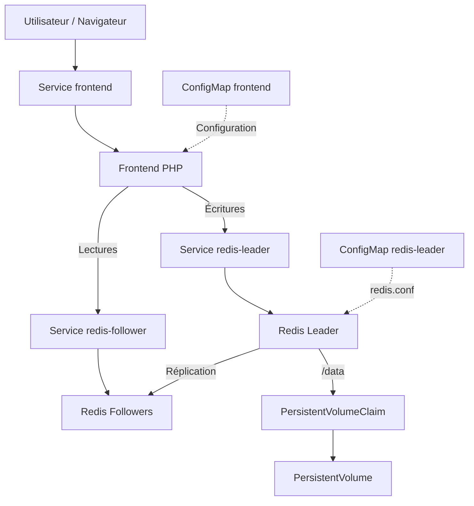

# Architecture — Cloud Guestbook

## 1. Présentation

Cloud Guestbook est une application de livre d'or basée sur une
architecture PHP + Redis, déployée sur Kubernetes.

Le projet utilise trois technologies principales :

- **Terraform** : provisionnement du cluster GKE Autopilot.
- **Kubernetes** : orchestration des composants applicatifs.
- **Helm** : packaging, configuration et déploiement de Guestbook.

L'application est déployée dans trois environnements indépendants :
`dev`, `staging` et `prod`.

## 2. Environnements d'exécution

### Environnement local

- Docker Desktop et Minikube.
- Trois namespaces Kubernetes.
- Trois releases Helm.
- Stockage persistant avec la StorageClass `standard`.
- Frontends accessibles grâce à `minikube tunnel`.

**État : déployé et validé.**

### Environnement cloud

- Google Kubernetes Engine (GKE) Autopilot.
- Cluster `autopilot-cluster-1`.
- Infrastructure déclarée avec Terraform.
- Même chart Helm que sur Minikube.
- Stockage dynamique fourni par la StorageClass du cluster.

**État : configuration Terraform validée, déploiement cloud
en attente d'accès au laboratoire Google Skills.**

## 3. Architecture applicative

Chaque namespace contient une instance indépendante de Guestbook.

### Fonctionnement

1. L'utilisateur accède au frontend PHP via un Service Kubernetes.
2. Le frontend envoie les écritures à `redis-leader`.
3. Les lectures sont effectuées via `redis-follower`.
4. Les followers répliquent les données du leader.
5. Redis Leader conserve ses données dans `/data`, sur un PVC.

Les noms `redis-leader` et `redis-follower` sont conservés car
ils sont utilisés par les images officielles de Guestbook.

## 4. Isolation des environnements

| Composant | dev | staging | prod |
|---|---|---|---|
| Release Helm | stack-dev | stack-staging | stack-prod |
| Frontend | 1 | 2 | 3 |
| Redis Leader | 1 | 1 | 1 |
| Redis Followers | 1 | 2 | 2 |
| PVC Redis | 1 GiB | 1 GiB | 2 GiB |
| Port frontend local | 8080 | 8081 | 8082 |

Chaque environnement possède ses propres Deployments, Services,
ConfigMaps et volumes persistants.

Les messages enregistrés dans un namespace ne sont pas partagés
avec les autres environnements.

## 5. Persistance des données

Le Redis Leader utilise :

- Un PersistentVolumeClaim monté sur `/data`.
- Un PersistentVolume provisionné dynamiquement.
- La persistance Redis AOF (`appendonly yes`).
- La synchronisation disque (`appendfsync always`).

La stratégie de déploiement du Redis Leader est `Recreate`.

Cette stratégie évite de faire fonctionner simultanément deux
instances du leader utilisant le même volume en écriture.

Une interruption temporaire du service est possible lors du
redémarrage du leader.

La persistance a été vérifiée sur Minikube après suppression et
recréation du Pod Redis Leader.

Un PVC ne constitue toutefois pas une sauvegarde indépendante.

## 6. Stratégies de déploiement

| Composant | Stratégie | Justification |
|---|---|---|
| Redis Leader | Recreate | Éviter deux processus écrivains concurrents |
| Redis Followers | RollingUpdate | Mettre à jour les replicas progressivement |
| Frontend | RollingUpdate | Réduire les interruptions de service |

Les conteneurs possèdent des readiness probes, liveness probes
et des ressources CPU/mémoire configurables.

## 7. Rôle de Terraform

Terraform utilise le module :

`terraform-google-modules/kubernetes-engine/google//modules/beta-autopilot-public-cluster`

Version : `~> 46.0`

Il est responsable du provisionnement du cluster GKE Autopilot.

Le déploiement de l'application n'est pas effectué par Terraform :
il est pris en charge par Helm.

Le state Terraform est local pour le laboratoire temporaire.
Dans un environnement d'entreprise, un backend distant sécurisé
avec contrôle d'accès et mécanisme de verrouillage serait préférable.

## 8. Rôle de Helm

Le chart réutilisable se trouve dans :

`helm/guestbook/`

Les différences entre les environnements sont configurées avec :

- `values-dev.yaml`
- `values-staging.yaml`
- `values-prod.yaml`

Le chart possède également un fichier `values.yaml` contenant
les valeurs par défaut.

Les versions du chart sont gérées dans `Chart.yaml`.

Les opérations `helm upgrade` et `helm rollback` ont été testées
sur Minikube avec conservation des données Redis.

La release de développement a été migrée depuis des manifestes
Kubernetes classiques vers Helm en conservant son PVC existant.

## 9. Exposition réseau

### Minikube

Les Services frontend utilisent le type `LoadBalancer`.

La commande `minikube tunnel` fournit l'accès local.

### GKE Autopilot

Le déploiement cloud est prévu en deux étapes :

1. Service `ClusterIP`, testé avec `kubectl port-forward`.
2. Passage en `LoadBalancer` avec `helm upgrade`.

Les Services Redis restent internes au cluster (`ClusterIP`).

## 10. Limites de sécurité et de disponibilité

Cette architecture constitue un laboratoire pédagogique et
non une infrastructure de production prête à l'emploi.

Limites identifiées :

- Redis n'utilise pas d'authentification.
- Redis utilise `protected-mode no` dans le laboratoire.
- Un seul Redis Leader est déployé.
- Pas de basculement automatique du leader.
- Absence de chiffrement HTTPS applicatif configuré.
- Pas de sauvegarde externalisée automatisée.
- La destruction du cluster GKE entraîne des risques de perte
  des données si aucune sauvegarde n'est conservée.

Des améliorations seraient nécessaires pour un déploiement
en production : authentification, TLS, NetworkPolicies, gestion
des secrets, sauvegardes externalisées et haute disponibilité.
